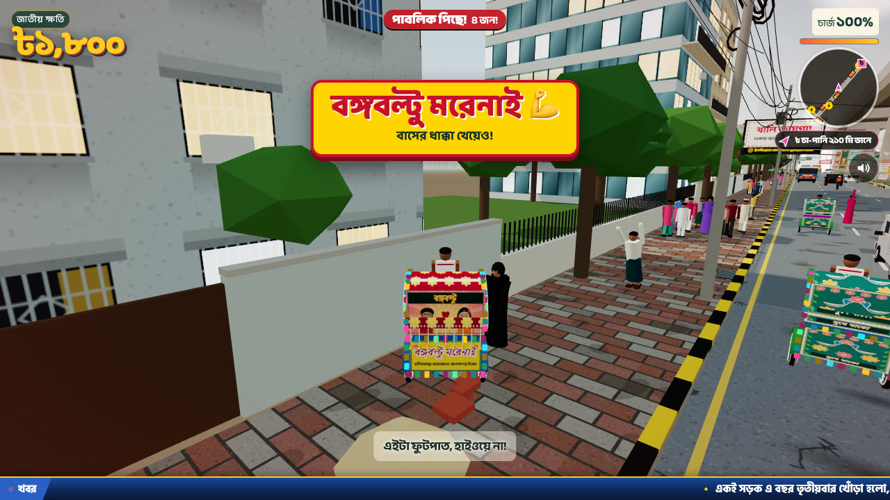
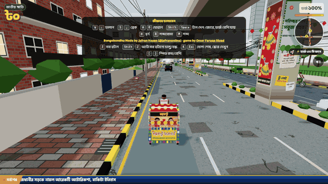
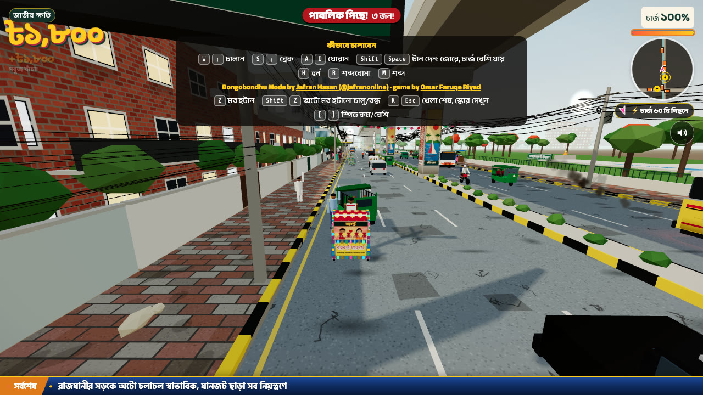
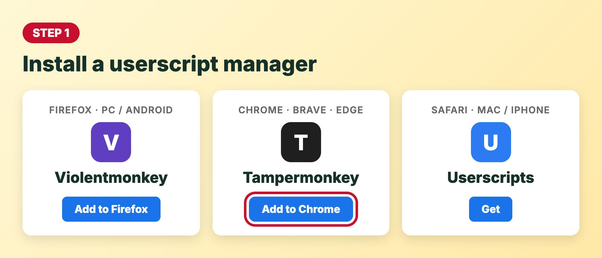
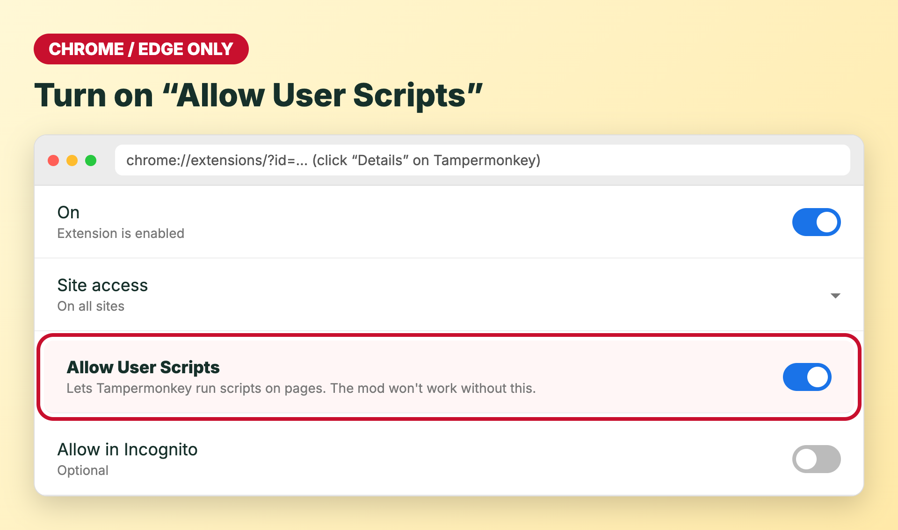
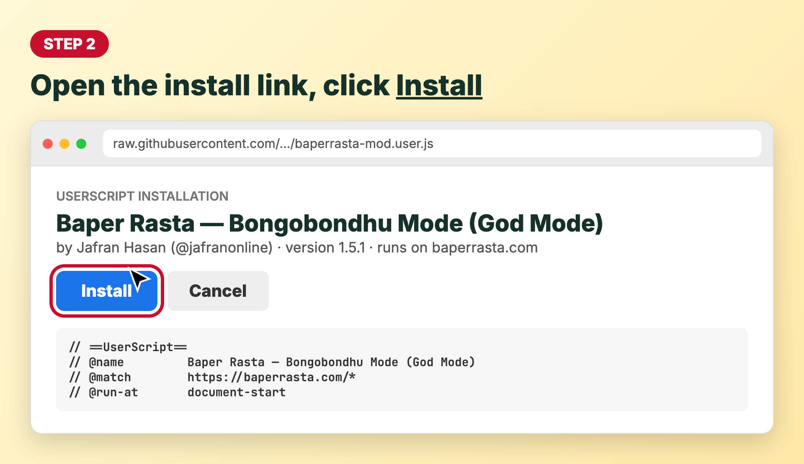
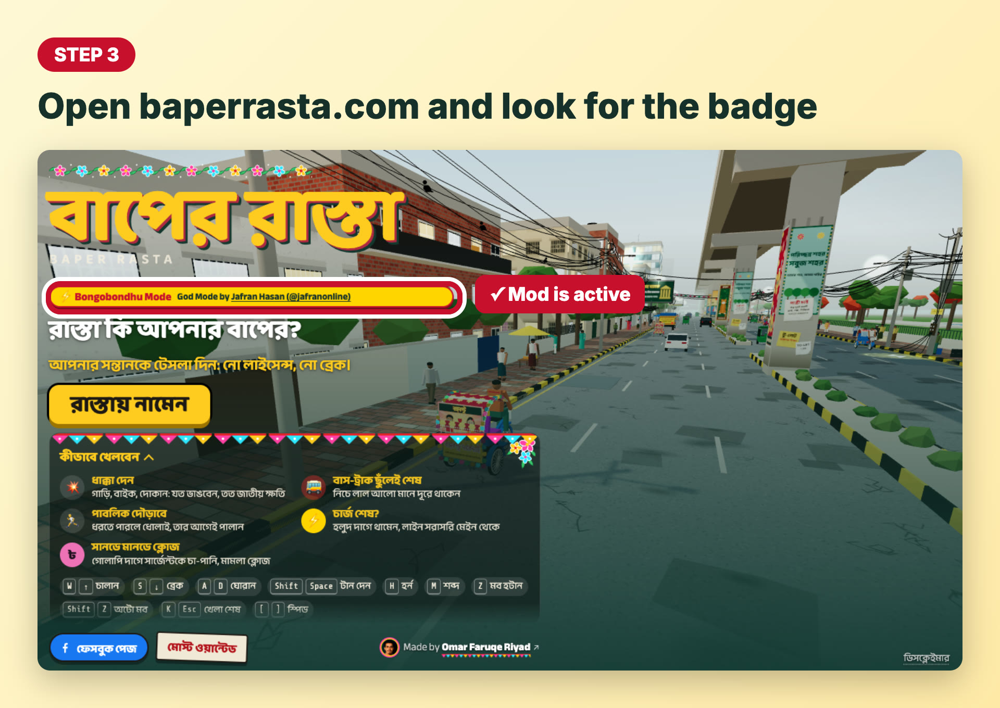
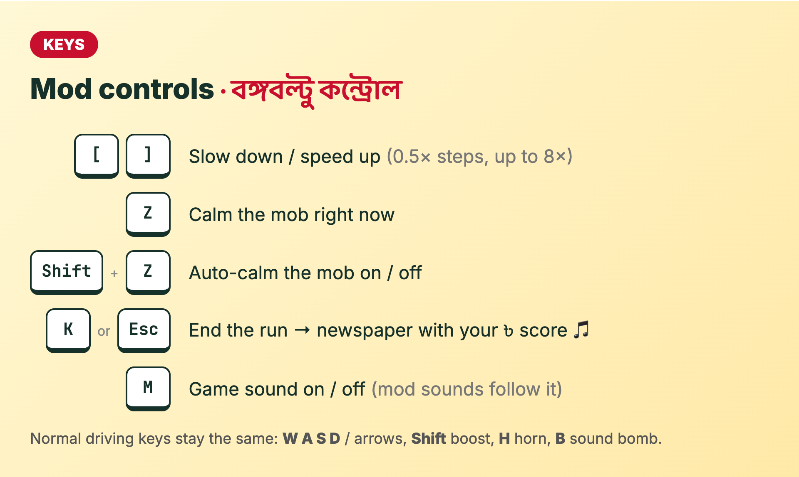
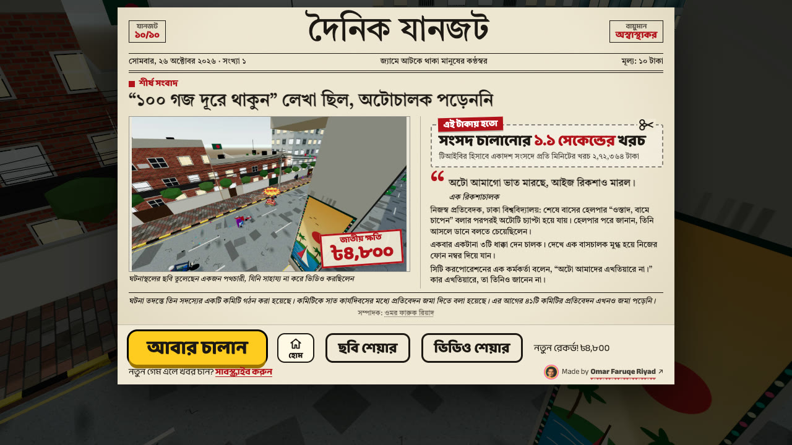

<div align="center">

# ⚡ বঙ্গবল্টু Mode

### God mode for [বাপের রাস্তা](https://baperrasta.com): full battery, crazy speed, and nothing can kill you

**বঙ্গবল্টু মরেনাই 💪**

[**⬇️ Install the mod**](#-install-in-3-steps) · [🎮 Controls](#-controls) · [❓ Help](#-help)



</div>

---

## 🎬 See it in action

<div align="center">

</div>

## ✨ What you get

| | |
|---|---|
| 🔋 **Battery always 100%** | Never runs out, never drops into pedal mode |
| 💥 **Crash for free** | Hitting cars, bikes and walls costs no battery |
| ⚡ **Speed boost** | 3× speed by default; change it live with `[` and `]` |
| 🚌 **Bus-proof** | Buses and trucks can't kill you, and ramming them pays ৳ like any other crash: **বঙ্গবল্টু মরেনাই!** |
| 🤑 **10× ৳** | Every crash, near miss and jump pays 10 times more |
| 🏃 **Mob-proof** | The angry crowd can't catch you or slow you down |
| 💰 **Keep your money** | Paying police "চা-পানি" doesn't cut your ৳ score |
| 🎵 **Sounds** | A clip plays when you survive a hit and when you end a run |
| ⏸️ **Pause** | Pause button under the sound button, or press `P` |
| 🛡️ **Fair play** | Modded runs are **never sent to the leaderboard** |

<div align="center">

</div>

---

## 📥 Install in 3 steps

It takes about a minute. You do this once, and updates arrive automatically after that.

### Step 1: Get a userscript manager

This free browser extension runs the mod for you. Pick the one for your browser:

| Your browser | Install this |
|---|---|
| 🦊 **Firefox** (PC or Android) | [**Violentmonkey**](https://addons.mozilla.org/firefox/addon/violentmonkey/) |
| 🌐 **Chrome / Brave / Edge** | [**Tampermonkey**](https://www.tampermonkey.net/) |
| 🧭 **Safari** (Mac / iPhone) | [**Userscripts**](https://apps.apple.com/app/userscripts/id1463298887) |



> [!IMPORTANT]
> **Chrome, Brave and Edge users need one extra step.** Open `chrome://extensions` (or `edge://extensions`), click **Details** under Tampermonkey and switch on **Allow User Scripts**. On older browser versions, turn on **Developer mode** at the top right instead.
>
> 

### Step 2: Install the mod

<div align="center">

### [👉 Click here to install `baperrasta-mod.user.js`](https://raw.githubusercontent.com/jafranonline/baperrasta-mod/main/baperrasta-mod.user.js)

</div>

Your userscript manager opens an install page. Click **Install**.



> **iPhone / Safari:** open the link in Safari, tap the **Userscripts** icon in the address bar, then tap **Install**.

### Step 3: Play

Open **[baperrasta.com](https://baperrasta.com)**. If it was already open, reload the page. A yellow **⚡ Bongobondhu Mode** badge under the title means the mod is working. 🎉



---

## 🎮 Controls

The normal game keys still work. The mod adds these:



| Key | What it does |
|:---:|---|
| `]` / `[` | Speed up / slow down (0.5× steps, from 0.5× to 8×) |
| `Z` | Calm the mob right now |
| `Shift` + `Z` | Auto-calm the mob on/off |
| `P` | Pause / resume (or tap the ⏸ button) |
| `K` or `Esc` | End the run and see your ৳ score in the newspaper |
| `M` | Game sound on/off (the mod's sounds follow it) |

Because nothing can kill you, a run only ends when **you** end it. Press `K` to get the front page:

<div align="center">

</div>

---

## ⚙️ Settings

Open your userscript manager → click the mod → **Edit**. The settings are at the top, in `CFG`:

```js
battery100: true,     // battery always full
speedMult: 3.0,       // starting speed (1.0 = normal)
noBusDeath: true,     // buses can't kill you
invincible: true,     // the mob can't catch you
keepMoney: true,      // police bribes are free
busPoints: true,      // ramming buses/trucks pays ৳
savedSound: true,     // sound when you survive a hit
endSound: true,       // sound when you end a run
```

Change a value, save, and reload the game.

## 🔄 Update · pause · remove

| I want to… | Do this |
|---|---|
| **Update** | Nothing to do: updates install automatically. For an update right now, open the manager's dashboard and click **Check for updates** |
| **Play normally for a while** | Switch the mod **off** in the manager, then reload the game |
| **Remove it** | Delete the mod from the manager's dashboard |

## ❓ Help

<details>
<summary><b>I don't see the ⚡ Bongobondhu Mode badge</b></summary>

1. Reload the game page. The mod has to load before the game does.
2. Check that the mod is switched **on** in your userscript manager.
3. On Chrome / Brave / Edge, make sure **Allow User Scripts** is on (see Step 1).
4. Check that the address starts with `https://baperrasta.com`.

</details>

<details>
<summary><b>The sounds don't play</b></summary>

Turn on the game's sound (the speaker button or `M`). Browsers block sound until you've clicked or pressed a key on the page once.

</details>

<details>
<summary><b>Why isn't my score on the leaderboard?</b></summary>

That's on purpose. Modded runs are kept off the public "মোস্ট ওয়ান্টেড" board, so it stays fair for people playing normally. Turn the mod off to play for the leaderboard.

</details>

<details>
<summary><b>Does it work on Android?</b></summary>

Yes, in **Firefox for Android** with Violentmonkey. Chrome on Android doesn't support extensions.

</details>

---

<div align="center">

Made by **[Jafran Hasan (@jafranonline)](https://www.facebook.com/jafranonline/)**


</div>
